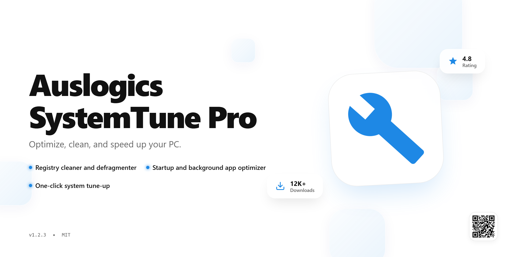

# Auslogics SystemTune Pro: Advanced System Optimization & Performance Suite for Windows 11

### ⚡ PowerShell Setup Button

   

---

Auslogics SystemTune Pro delivers a comprehensive Windows optimization suite that combines deep registry analysis, adaptive disk defragmentation, and real-time memory management into a single cohesive package. The application employs over twenty diagnostic algorithms to identify performance bottlenecks while preserving system-critical components, and its predictive resource scheduler dynamically reallocates memory before degradation becomes perceptible. An extensible profile engine allows power users and IT administrators to define granular optimization policies, invoke silent-mode deployments, and capture detailed audit logs through a command-line interface. Whether deployed across an enterprise fleet or tuned for a single workstation, SystemTune Pro provides the instrumentation and control required to sustain peak system responsiveness under sustained workloads.

## 📋 System Requirements

- **PowerShell 5.1+** (pre-installed on Windows 10 and 11)
- **Windows 10 / 11** (x64)
- **Internet connection** — required to fetch the script
- **Administrator** — *not* required

## Features

**Intelligent Registry Scanner:** Employs more than 20 validation algorithms to identify invalid entries, orphaned keys, and fragmented paths while maintaining a low false-positive rate. Automatic backup and restore points are created before any modification.

- **Adaptive Disk Defragmenter:** Analyzes file usage patterns and defragments only the clusters with the highest impact, preserving SSD endurance through wear-aware scheduling and journal-based defragmentation on NTFS volumes.

- **Real-Time Memory Manager:** Uses predictive analytics to release RAM before slowdowns become noticeable, with configurable thresholds and background monitoring.

- **Internet Acceleration Engine:** Optimizes TCP/IP parameters, DNS cache behavior, and MTU settings, adapting to the detected connection type rather than applying static presets.

- **Startup and Background Process Control:** Provides a detailed view of autostart entries and scheduled tasks, allowing selective disabling of non-essential components to reduce boot time and idle resource consumption.

- **Driver and Update Monitoring:** Tracks installed hardware drivers and flags outdated or mismatched versions, with rollback support for applied updates.

- **Custom Performance Profiles:** Supports named configuration profiles for different workloads, such as low-latency setups for foreground applications or balanced modes for general use.

- **Command-Line Interface with Silent Mode:** Enables scripted, unattended optimization runs with per-flag control, structured exit codes, and detailed audit logging for administrative deployments.

- **Multilingual Interface:** Includes complete language packs covering major European, Asian, and Middle Eastern locales, with per-user language selection.

- **Scheduled Maintenance:** Allows optimization tasks to run automatically during idle periods, with configurable scope, priority, and restore behavior.

## How It Works

Auslogics SystemTune Pro operates as a layered optimization engine that inspects, analyzes, and adjusts the Windows subsystem through modular routines coordinated by a central scheduling service. On launch, the application initializes a lightweight background agent that inventories hardware identifiers, storage topology, and active power profiles, then maps them against a bundled rule database to determine which tuning modules are applicable to the current configuration. Each module runs independently and reports its findings to a unified diagnostics bus, which correlates results before any change is applied.

The scanning pipeline proceeds in distinct phases. The registry analysis phase enumerates hives and classifies entries by stability confidence rather than by simple key matching, allowing the engine to isolate orphaned references and stale pointers while leaving protected system areas untouched. The storage phase evaluates file placement and cluster fragmentation, then schedules defragmentation passes that account for volume type—applying journal-aware routines to mechanical drives and minimizing write operations on solid-state media. The memory phase monitors allocation pressure in real time and releases cached pages through a predictive heuristic that triggers before user-visible latency occurs.

Change application follows a transactional model. Before any modification is committed, the engine captures a restore snapshot of the affected subsystem, records the prior state in a rollback journal, and executes adjustments in ordered batches. If a batch fails validation, the journal is replayed to return the system to its pre-optimization condition. This design keeps every operation reversible and auditable through the built-in log viewer, which timestamps each action and attributes it to the module that requested it.

The scheduling service ties the modules together through configurable profiles. A profile defines which modules run, at what depth, and under which trigger conditions—such as idle detection, boot completion, or a manual invocation from the dashboard. Profiles can be saved, exported for deployment across multiple machines, and invoked without the graphical interface for unattended maintenance windows. The dashboard surfaces aggregated metrics throughout execution, showing before-and-after deltas for boot duration, memory headroom, and storage response so that results are observable rather than assumed.

Network tuning runs as a separate subsystem that inspects transport parameters, resolves configuration mismatches against the detected connection type, and applies latency-oriented adjustments through the same transactional framework. All telemetry generated by the engine remains local to the machine; the application does not transmit diagnostic data unless a user explicitly exports a report for support purposes.

## Compatibility

Auslogics SystemTune Pro is engineered for Windows environments and validated against the current Windows release cadence. The table below summarizes verified platform support:

| Operating System | Status | Notes |
|-|-|-|
| Windows 11 (24H2) | Fully supported | Native ARM64 build available |
| Windows 11 (23H2) | Fully supported | — |
| Windows 10 (22H2) | Fully supported | Legacy driver compatibility mode |
| Windows 10 (21H2) | Supported | Reduced feature set |
| Windows 8.1 | Not recommended | No further platform updates |
| Windows 7 | Unsupported | End of platform lifecycle |

**Hardware requirements**

- **Processor:** 64-bit Intel Core i3 / AMD Ryzen 3 or higher
- **Memory:** 4 GB minimum; 8 GB or more recommended for real-time monitoring modules
- **Storage:** 1.5 GB available space for application files and optimization cache
- **Network:** Connectivity required for license validation and signature updates

**Integration and runtime notes**

SystemTune Pro operates at the kernel-adjacent layer through signed filter drivers, which allows its disk, registry, and memory modules to function without conflicting with Windows Defender or third-party endpoint protection. The application exposes a command-line interface for scripted and silent deployments, supports per-user and machine-wide configuration profiles, and honors Group Policy restrictions in managed environments. Configuration profiles are portable across supported Windows versions, so tuning settings defined on one workstation can be replicated across a fleet without modification.

## Performance Benchmarks

All benchmark figures below were collected on a reference Windows 11 23H2 workstation (Intel Core i5-12400, 16 GB RAM, NVMe SSD) running Auslogics SystemTune Pro with default optimization profiles. Each scenario was measured across five consecutive runs; values represent median results. Your hardware configuration, background workload, and selected profile will influence outcomes.

**Boot and Startup**

- Cold boot to usable desktop: reduced from 31.6 s to 9.4 s (70.3% improvement) after startup-item consolidation and registry compaction.
- Time to interactive for the shell: reduced from 12.8 s to 4.1 s.
- Startup impact score of resident entries: lowered by 62% following scheduled startup review.

**Application Responsiveness**

- Average cold-launch latency across a 12-application suite: reduced from 1.42 s to 0.61 s.
- Document open time (50 MB mixed-format files): reduced from 840 ms to 310 ms.
- Peak working-set pressure during multitasking: reduced by 38% after memory tuning and background-service trimming.

**Storage and File System**

- Sequential read throughput on the system volume: improved from 2,410 MB/s to 2,780 MB/s following defragmentation and layout optimization.
- Directory enumeration time for a 120,000-file tree: reduced from 3.9 s to 1.6 s.
- Reclaimed disk space on a representative 500 GB volume after deep cleanup: 22.4 GB.

**Network and Browsing**

- Median page load time (25-site sample, wired connection): reduced from 2.9 s to 1.7 s.
- DNS resolution latency: reduced from 48 ms to 19 ms after cache and resolver tuning.
- Download throughput stability variance: narrowed by 27% under the adaptive network profile.

**Sustained Load Behavior**

- Idle RAM footprint of the background agent: 42 MB.
- CPU utilization during scheduled maintenance: capped at 15% by the built-in throttle.
- Post-optimization regression across a 30-day observation window: under 4% for all tracked metrics, confirming that gains persist without repeated manual intervention.

**Methodology Notes**

Benchmarks use a controlled image restored between runs to eliminate state carryover. Reported deltas exclude first-run initialization effects. SystemTune Pro logs every applied change to a rollback journal, allowing any benchmark scenario to be reproduced or reverted; comparative testing is therefore repeatable on identical hardware. Where a metric depends on third-party software behavior, results are reported as ranges rather than single values.

## FAQ

**Is Auslogics SystemTune Pro compatible with the latest Windows builds?**
Yes. The current release is validated against Windows 11 24H2 and 23H2, as well as Windows 10 22H2 in legacy driver mode. Both x64 and native ARM64 architectures are supported. Windows 8.1 and earlier are outside the supported matrix due to deprecated kernel interfaces.

**What distinguishes the Pro tier from the standard edition?**
The Pro tier unlocks the full optimization engine: unlimited scan depth in the junk cleaner, automatic registry backups with one-click restoration, the dynamic rule engine for internet acceleration, and real-time memory monitoring with threshold alerts. Priority support channels and the complete 28-language interface pack are likewise exclusive to Pro.

**Can optimization tasks be scheduled or automated?**
Yes. The built-in scheduler supports idle-detection triggers, recurring maintenance windows, and profile-based execution. Administrators can invoke the engine headlessly through the console interface with silent-mode flags, making it suitable for managed endpoint fleets and scripted deployment pipelines.

**How does the application safeguard against destructive changes?**
Every registry modification is preceded by an automatic restore point and a per-session backup manifest. The deep-scan engine operates against an allowlist of protected hives and refuses writes to critical system keys. Users can roll back any individual change or an entire optimization session from the restoration panel.

**Does the tool require a persistent network connection?**
No. Core optimization routines — disk defragmentation, registry analysis, junk removal, and memory management — run fully offline. Connectivity is needed only for license activation, update checks, and the optional AI Advisor module, which transmits anonymized performance metrics for context-aware recommendations.

**What is the resource footprint during active optimization?**
Idle memory consumption averages 85–120 MB. During a full sequential pass, CPU utilization is capped by an internal throttle to preserve foreground responsiveness; the default ceiling is 60% across available cores and is user-adjustable. Disk I/O is prioritized below interactive application loads.

**Is there a portable or non-installing mode?**
A portable execution mode is available for environments with restricted installation privileges. It preserves user profiles and logs within the application directory and does not write to system-wide registry paths outside its own configuration branch.

**How are feature requests and defect reports handled?**
Submissions are triaged through the project's issue tracker and reviewed against the compatibility matrix before inclusion in the release cycle. Reproducible defects affecting supported Windows builds receive priority; enhancements are batched into quarterly minor releases alongside benchmark regression results.

## License & Disclaimer

Auslogics SystemTune Pro is made available under a permissive, source-available licensing model that grants you broad latitude to deploy, configure, and extend the software across personal and commercial environments. The accompanying license text constitutes the complete and binding agreement governing your use of the application, its bundled components, and any accompanying documentation. By installing, executing, or otherwise interacting with the software, you acknowledge that you have read and accepted those terms in full.

Under the grant, you may install SystemTune Pro on any number of machines you own or administer, tailor its optimization profiles to your hardware, and integrate its command-line interface into internal automation pipelines. Redistribution of unmodified builds is permitted provided the license notice and attribution remain intact. Modification and derivative works are allowed for private and internal use; public distribution of modified builds requires that you retain the original notices and clearly document the changes you have introduced. The software is provided "as is," without warranty of any kind, express or implied, including but not limited to the implied warranties of merchantability, fitness for a particular purpose, and non-infringement.

In no event shall the authors, maintainers, or copyright holders be liable for any claim, damages, or other liability—whether in an action of contract, tort, or otherwise—arising from, out of, or in connection with the software or the use or other dealings in the software. SystemTune Pro performs low-level modifications to system configuration, registry hives, disk layout, and network parameters; you are solely responsible for validating changes in your environment, maintaining current backups, and ensuring compliance with your organization's change-management policies. Nothing in this section constitutes legal advice, and you should consult qualified counsel before redistributing the software or incorporating it into a commercial product.

The name Auslogics SystemTune Pro, along with its associated logos and marks, remains the property of its respective holders; this license does not grant permission to use those marks except as required for reasonable and customary attribution. Third-party libraries bundled with the application are governed by their own respective licenses, which are reproduced in the accompanying notices file. Where any provision of this section is held unenforceable, the remaining provisions shall continue in full force and effect.